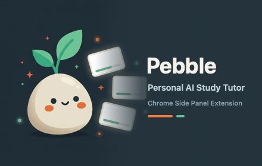

<div align="center">


# Pebble — Personal AI Study Tutor

**Your personal AI academic tutor and virtual study companion that lives in your Chrome Side Panel.**

[](https://github.com/will-iam08/Pebble-Personal-Ai-Tutor/releases/latest)
[](./LICENSE)
[](./chrome-extension/manifest.json)
[](./package.json)
[](https://github.com/will-iam08/Pebble-Personal-Ai-Tutor/actions/workflows/ci.yml)

[Features](#-features) • [Supported AI Models](#-supported-ai-models) • [Quick Start](#-quick-start) • [Architecture](#-architecture) • [Roadmap](#-roadmap) • [Privacy Policy](./PRIVACY.md) • [Chrome Web Store Guide](./docs/CHROME_WEB_STORE.md)

<p>
  
</p>

</div>

---

## What is Pebble?

Pebble turns any webpage, lecture PDF, or set of class notes into an interactive study session right beside what you're reading. Instead of copy-pasting chapters into a generic chat window, Pebble extracts your study material into structured summaries, exam-style quizzes with AI grading, flashcards, a vocabulary bank, and grounded tutor Q&A — all paired with **Pebble**, a cozy study companion pet that levels up as you learn.

---

## Features

### Multi-Source Study Reader
- **Active Tab & YouTube Transcript Extraction:** Pulls clean article/textbook content from your current Chrome tab — and automatically extracts timestamped captions when you're watching a YouTube lecture.
- **Screenshots & Diagrams (Vision):** Capture the visible browser tab in one click (in the Chrome extension), upload `.png`/`.jpg`/`.webp` images, or press `Ctrl+V` / `Cmd+V` anywhere in Pebble to study math equations, graphs, and charts.
- **Highlight-to-Ask Context Menu:** Right-click highlighted text on any webpage to **Ask Pebble** or **Save to Pebble Vocab** directly inside the Side Panel.
- **PDF & Notes Support:** Upload lecture slide PDFs directly (native PDF reading on Gemini & Claude) or paste raw study notes.

### AI Academic Study Tools
- **Socratic Tutor Mode & Learner Profiles:** Switch between **Socratic** (guided hints & diagnostic questions with a one-click *Reveal direct answer* escape hatch) and **Direct** explanations, calibrated for **High School / AP**, **Undergrad**, or **Graduate** depth.
- **LaTeX Math & Rich Markdown Rendering:** Crisp KaTeX equations (`$...$` / `$$...$$`), tables, and formatted code blocks across Summary, Quiz, Study Tips, Flashcards, Vocab, and Tutor Chat.
- **Structured Lecture Summaries:** Generates a crisp TL;DR, difficulty rating, key concepts, formulas/formal definitions, and common exam traps with tips to avoid them.
- **Interactive Quizzes & AI Grading:** Builds 5–10 multiple-choice, short-answer, or mixed questions with step-by-step explanations and conceptual grading for written responses.
- **Study Tips & Active-Recall Flashcards:** Produces tailored study strategies, mnemonics/memory hooks, and flippable flashcards with hints.
- **Grounded Tutor Chat:** Ask follow-up questions anchored directly to your loaded reading or PDF.
- **Vocabulary Bank:** Collect terms from summaries, chat, or manually; generate plain-language definitions, analogies, and memory cues; track mastered terms.
- **Study Exports:** Download summaries, tutor chats, or combined study packs as Markdown (`.md`) or plain text (`.txt`).

### Virtual Companion & Focus Tools
- **Study Companion Pet:** Earn XP and Study Treats as you study. Evolve Pebble through 4 stages (**Seedling → Sproutling → Leafkin → Scholar**), unlock accessories on the interactive pet habitat canvas, and keep Pebble fed and happy.
- **Pomodoro Timer & Focus Mode:** Built-in focus/break timer with sound effects, light/dark themes, and distraction-free focus view.
- **Daily Missions, Streaks & Analytics:** Track 7-day study time, quiz accuracy charts, daily streaks, and unlockable achievements.
- **Gentle Check-In Reminders:** Optional Chrome desktop notifications via `chrome.alarms` & `chrome.notifications`.

---

## Supported AI Models

Pebble is **Bring Your Own Key (BYOK)** — your API keys stay strictly in local browser storage and requests go directly from your browser to your chosen provider.

| Provider | Cost / Tier | Native PDF Upload | Highlights |
| :--- | :--- | :---: | :--- |
| **Google Gemini** | Free tier available | Yes | Default `gemini-2.5-flash` via [Google AI Studio](https://aistudio.google.com/apikey) |
| **OpenRouter** | Free (`:free`) & paid models | No | Access `openrouter/free`, Llama 3.3, DeepSeek R1, Gemma 3, Claude, GPT |
| **Ollama / LM Studio** | 100% Free & Local | No | Private on-device models with one-click local model discovery |
| **Local CLI Bridge** | Existing subscriptions | No | Connect Claude Code (Claude Pro/Max), Codex (ChatGPT Plus/Pro), or Gemini CLI locally via `npm run bridge` |
| **OpenAI** | BYOK API key | No | `gpt-4o-mini`, `gpt-4o`, `o4-mini`, or custom model ID |
| **Anthropic Claude** | BYOK API key | Yes | Direct browser access with `claude-sonnet-4` & `claude-3-5-haiku` |
| **Local Server (`.env`)** | Web dev mode | Yes | Uses `server/index.ts` + `GEMINI_API_KEY` for local web sandbox development |

> **Tip for Ollama in Chrome:** Start Ollama with `OLLAMA_ORIGINS="*"` so Chrome extensions can reach `http://localhost:11434/v1`.

---

## Quick Start

### Option 1: Install the Pre-Built Chrome Extension (Fastest)

1. Download **`pebble-chrome-extension-v2.3.0.zip`** from the [Latest GitHub Release](https://github.com/will-iam08/Pebble-Personal-Ai-Tutor/releases/latest) and unzip it.
2. Open Chrome and navigate to `chrome://extensions/`.
3. Enable **Developer mode** (top-right toggle) → click **Load unpacked** → select the unzipped folder.
4. Click the **Pebble** icon in your toolbar, click **AI Key** (or the gear icon), pick a free or BYOK provider (Gemini free tier, OpenRouter, Ollama, or Local CLI Bridge), and click **Test Connection**.

### Option 2: Build the Chrome Extension from Source

**Prerequisites:** Node.js 20+.

```bash
# 1. Clone and install dependencies
git clone https://github.com/will-iam08/Pebble-Personal-Ai-Tutor.git
cd Pebble-Personal-Ai-Tutor
npm install

# 2. Build the unified React Chrome Extension into dist-extension/ (or npm run package:extension for a .zip)
npm run build:extension
```

3. Open Chrome and navigate to `chrome://extensions/`.
4. Enable **Developer mode** (top-right toggle).
5. Click **Load unpacked** and select the **`dist-extension/`** folder.
6. Click the **Pebble** toolbar icon to open the Side Panel, click **AI Key** (or the gear icon), pick a free or BYOK provider (Gemini free tier, OpenRouter, or local Ollama), and click **Test Connection**.

### Option 3: Run the Web Workspace Locally

```bash
# Optional: configure server-side Gemini key for "Local Server (.env)" mode
cp .env.example .env

# Start the Express + Vite dev server (http://localhost:3000)
npm run dev
```

You can also switch directly to any BYOK provider (Gemini, OpenRouter, Ollama, OpenAI, Claude) inside Settings even when running the web workspace.

#### Available Scripts

| Command | Description |
| :--- | :--- |
| `npm run dev` | Start Express + Vite dev server (`http://localhost:3000`) |
| `npm run bridge` | Start Local CLI Subscription Bridge (`http://127.0.0.1:4318`) for Claude Code / Codex / Gemini CLI |
| `npm run build` | Build the production web app to `dist/` |
| `npm run build:extension` | Build the unified React Chrome Extension (MV3) to `dist-extension/` |
| `npm run build:all` | Build both web (`dist/`) and Chrome extension (`dist-extension/`) |
| `npm run package:extension` | Build and package `release/pebble-chrome-extension-v*.zip` for Chrome Web Store |
| `npm run lint` | Run TypeScript typechecking (`tsc --noEmit`) |
| `npm test` | Run unit tests (FSRS scheduler, Anki MathJax export, JSON parser) |
| `npm start` | Run the server in production mode |

---

## Architecture

One shared React + TypeScript UI compiles cleanly to **both** the Chrome Side Panel extension (`dist-extension/`) and the standalone web sandbox (`dist/`):

```text
Pebble-Personal-Ai-Tutor/
├── chrome-extension/           # MV3 manifest, icons, service worker & content script
│   ├── icons/                  # Extension icons (16x16, 32x32, 48x48, 128x128)
│   ├── manifest.json           # Permissions, side panel config & provider host permissions
│   ├── background.js           # Active-tab / LMS PDF extraction bridge + check-in alarms
│   └── content.js              # Clean DOM & YouTube transcript extractor
├── docs/
│   ├── CHROME_WEB_STORE.md     # Chrome Web Store submission guide
│   └── assets/                 # Chrome Web Store listing artwork (icon, promo tile & screenshot)
├── scripts/                    # Store validation & release zip bundler (package-extension.mjs)
├── server/
│   ├── index.ts                # Optional local Express proxy (/api/tutor/*) + Vite middleware
│   └── pebble-bridge.ts        # Optional local subscription CLI bridge (claude, codex, gemini)
├── sidepanel.html              # Chrome Side Panel HTML entry (built by vite.extension.config.ts)
├── vite.extension.config.ts    # Builds unified React Side Panel + MV3 scripts into dist-extension/
├── src/                        # Shared React 19 + TypeScript + Tailwind v4 codebase
│   ├── sidepanel.tsx           # Extension entrypoint (<App mode="extension" />)
│   ├── main.tsx                # Web sandbox entrypoint (<App mode="web" />)
│   ├── components/             # Summary, Quiz, Tips, Chat, Vocab, Analytics, Settings, Pet Habitat
│   ├── utils/                  # aiClient, fsrs, tutorPrompts, extensionBridge, storage, missions
│   └── types/                  # AI provider catalog + study, pet, and quiz TypeScript models
├── tests/                      # Automated unit tests (pebble.test.ts)
├── PRIVACY.md                  # Public Privacy Policy for Chrome Web Store review
└── .github/                    # CI workflow (with .zip artifact), issue forms, and PR template
```

---

## Roadmap

### Stage 1 — Open-Source Foundation
- [x] MIT License, README, Contributing guide, Issue/PR templates, and GitHub Actions CI
- [x] Configurable model environment variable (`GEMINI_MODEL`) and repo hygiene cleanup

### Stage 2 — Unified Extension & Multi-Provider BYOK
- [x] **Unified React Chrome Extension:** Compiles the full `src/` React Side Panel directly into Manifest V3 (`dist-extension/`) with every tab, Pomodoro timer, Vocab bank, Analytics, and Pet Habitat
- [x] **Multi-Provider BYOK (Free & Paid Models):** Direct browser support for Google Gemini (free tier), OpenRouter (free & paid), Ollama / LM Studio (local & free), OpenAI, and Anthropic Claude with built-in connection testing

### Stage 3 — Academic Tutor v1 Upgrades
- [x] **Socratic Tutor Mode & Learner Profiles:** Guide students with hints and diagnostic questions before revealing answers (with one-click *Reveal direct answer*), calibrated for High School / AP, Undergrad, and Graduate depth
- [x] **LaTeX Math & Rich Markdown Rendering:** Full KaTeX math equations, tables, and formatted code blocks across Summary, Quiz, Study Tips, Flashcards, Vocab, and Chat
- [x] **Multimodal & Video Capture:** One-click tab screenshot capture & clipboard image paste (`Ctrl/Cmd+V`), YouTube lecture transcript import, and right-click Highlight-to-Ask / Save-to-Vocab context menu

### Stage 4 — FSRS Spaced Repetition, Anki Export & Subscription Bridge
- [x] **FSRS Spaced Repetition & Anki Export:** Built-in FSRS-4.5 review queue (Again / Hard / Good / Easy with live interval previews) for flashcards & vocabulary, plus one-click Anki TSV export with MathJax LaTeX support
- [x] **Optional Local CLI Subscription Bridge:** Lightweight local bridge (`npm run bridge`, inspired by T3 Code) connecting Claude Code, OpenAI Codex CLI, and Gemini CLI subscriptions safely on `127.0.0.1:4318`
- [x] **Automated Unit Tests & CI:** Node test suite (`npm test`) covering FSRS scheduling, Anki MathJax export, deck deduplication, and resilient JSON parsing

### Up Next (Community Wishlist)
- [x] **Chrome Web Store Packaging:** Extension icons (`16`/`32`/`48`/`128`), `440x280` store promo tile, [Privacy Policy](./PRIVACY.md), [Chrome Web Store Submission Guide](./docs/CHROME_WEB_STORE.md), and automated `.zip` artifact in GitHub Actions
- [ ] **Cross-Device Deck Sync:** Optional encrypted export/import or cloud sync for study decks and companion progress

---

## Contributing

Contributions, bug reports, and feature ideas are welcome! Check out [CONTRIBUTING.md](./CONTRIBUTING.md) to get started, or browse open [Issues](https://github.com/will-iam08/Pebble-Personal-Ai-Tutor/issues).

---

## License

Released under the [MIT License](./LICENSE).
